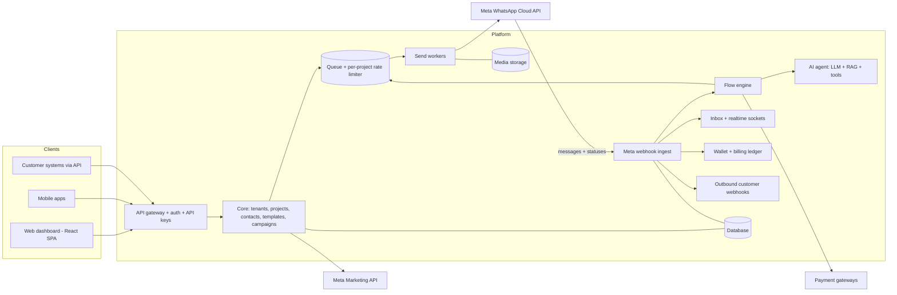

# Build Blueprint — Your Own WhatsApp Marketing Platform

> Input: the public analysis in [`aisensy-reverse-engineering.md`](./aisensy-reverse-engineering.md).
> This is an **original design**. AiSensy's internals are not public, so section 1 is labelled **[I] inference**. Facts about Meta's platform marked *verify* must be checked against Meta's current docs before you build.

---

## 1. How a platform like AiSensy most likely works [I]

Key mechanics, each tied to something AiSensy publishes:
1. **Onboarding.** "Log in with Facebook" = Meta Embedded Signup. The platform stores the customer's WhatsApp Business Account and phone-number IDs in a **Project** (their API keys and tags are scoped per project).
2. **Broadcast.** A segment expands into recipients, which go onto a queue. Workers send at the plan's speed cap (their tiers: 40 / 250 / 1,000 msg/s), most likely with a token bucket per project, and also respect Meta's per-number limits (*verify*).
3. **Status tracking.** Meta status webhooks (sent / delivered / read / failed) build each recipient's timeline. That timeline drives retargeting audiences ("read", "failed"…), analytics, automatic retries and wallet debits.
4. **Inbound routing.** An inbound message opens or extends the 24-hour service window. The message then goes to the contact's active flow session, else the AI agent, else the inbox. Inbox states are **Requesting / Active / Intervened**.
5. **Click tracking.** Only URL buttons can be tracked. This fits per-recipient redirect links placed in the URL button's dynamic suffix.
6. **Wallet.** The balance is checked before a send. Each billable delivered message is then debited by category and recipient country. A minimum balance keeps bots running.

---

## 2. Decision: how you get WhatsApp access

| Option | What it means | Pros | Cons |
|---|---|---|---|
| **A. Become a Meta Tech Provider** (own Meta app + Cloud API + Embedded Signup) | Business verification, app review for WhatsApp permissions (*verify current list*) | Full control, own brand, best margins, real product moat | Weeks of approvals; you own compliance and the billing setup with Meta |
| **B. Build on a BSP's partner API** | Use a Solution Partner's API as your backend (AiSensy advertises a "Direct API" partnership) | Fast start; BSP handles Meta | Vendor lock-in, revenue share, less control over speed and features |
| **C. White-label reseller** | Rebrand an existing platform (AiSensy offers this) | Launch in days, no development | No differentiation, thin margins, they own the product |

**Recommendation:** use **A** for a real product. You can run **C** in parallel only to test demand while A is being approved.

> 📋 Architectural decision detected: WhatsApp access model (Tech Provider vs BSP API vs white-label). Document reasoning and tradeoffs? Run `/sp.adr whatsapp-access-model`

---

## 3. Reference architecture (suggested stack)

| Concern | Suggested choice | Why |
|---|---|---|
| Dashboard + marketing site | Next.js (React) + Tailwind | One codebase: app pages plus SEO pages (their growth engine is SEO) |
| API & webhooks | Node.js (NestJS/Fastify) **or** Python (FastAPI) | I/O-heavy webhook and queue work |
| Database | PostgreSQL (Neon), JSONB for custom attributes | Multi-tenant relational data, flexible fields |
| Queue / rate limiting | Redis + BullMQ | Per-project token buckets give plan speed tiers |
| Realtime inbox | WebSockets (Socket.IO) | Live chat and agent presence |
| Media | S3-compatible object storage | Template and chat media |
| AI agents | LLM API (e.g. Claude: `claude-haiku-5-5` for chat replies, `claude-sonnet-5-5` for flow/template generation) + pgvector for RAG | Knowledge-base answers, tool calling |
| Billing | Subscription billing (Stripe / Chargebee / Razorpay) + your own wallet ledger | Plans plus prepaid message credits |
| Integrations | Signed outbound webhooks + an n8n node / Zapier app | "2000+ apps" without custom code |
| Mobile | React Native (later phase) | Reuse web logic |

---

## 4. Core data model (first draft)

| Entity | Key fields / relations |
|---|---|
| Tenant | company, plan, billing account |
| User | tenant_id, role (owner / admin / agent), 2FA |
| Project | tenant_id, waba_id, phone_number_id, display_name, quality_rating, messaging_limit_tier, access token (encrypted) |
| Contact | project_id, phone (E.164), name, opt_in_status, source, first_message_tag |
| Tag / ContactTag | many-to-many |
| AttributeDefinition / AttributeValue | per-project custom fields (typed) |
| Segment | project_id, filter (JSON rules over tags/attributes/events) |
| Template | project_id, name, language, category, components (JSON), status, meta_template_id, ttl |
| Campaign | type (broadcast / api / scheduled / retarget / drip), template_id, audience, schedule, status, budget |
| CampaignRecipient | campaign_id, contact_id, wa_message_id, sent/delivered/read/clicked/replied/failed timestamps, error_code, retries |
| Conversation | contact_id, window_expires_at, state (bot / requesting / intervened / closed), assignee_id |
| Message | conversation_id, direction, type, payload (JSON), wa_message_id, status, billing_category, cost |
| Flow / FlowSession | trigger config + graph (JSON); session: contact, current_node, variables, expires_at |
| AIAgent / KnowledgeSource / Chunk | prompt, tone, tools, model; URL or PDF sources; embeddings |
| WalletLedger | project_id, amount, type (topup / debit / refund / adjustment), message_id (unique for debits) |
| Subscription / PlanLimits | plan, cycle, renews_at; limits: speed, seats, tags, attributes, segments, webhooks |
| ApiKey, OutboundWebhook, Integration, AuditLog | developer platform and enterprise needs |

---

## 5. Critical flows with acceptance checks

### 5.1 Onboarding
- [ ] A test business completes Embedded Signup. The platform stores the WABA ID, phone-number ID and token (encrypted), registers the number and subscribes to webhooks.
- [ ] The dashboard shows display-name status, quality rating and messaging-limit tier.
- [ ] Error path: if signup fails or the number is already in use, the user sees a clear reason and a retry path.

### 5.2 Broadcast
- [ ] The segment is snapshotted into recipients. Opted-out, blocked and invalid numbers are excluded and counted.
- [ ] The wallet is pre-checked against the estimated cost. A broadcast that would overdraw the wallet is blocked with a top-up prompt.
- [ ] The send rate never exceeds the plan cap (load test at 2× the cap).
- [ ] Every recipient gets a status timeline. Retryable failures are retried up to N times with backoff; non-retryable errors are not retried.

### 5.3 Inbound routing
- [ ] An inbound message updates the 24-hour window.
- [ ] Routing order: active flow session → AI agent (if enabled) → inbox "Requesting".
- [ ] Agent takeover sets the state to "Intervened" and pauses the bot until the chat is resolved.
- [ ] A reply outside the window is blocked unless it is a template.

### 5.4 Billing
- [ ] Each wallet debit happens exactly once per billable `wa_message_id`, so duplicate webhooks don't double-charge.
- [ ] Debits use a per-country rate card, and the monthly free service-message quota is tracked per number.
- [ ] A daily reconciliation report compares the ledger with Meta's billing data.

### 5.5 Developer API & webhooks
- [ ] `POST /v1/messages/template` (or `/v1/campaigns/{name}/send`). The API key goes in a header, never in the body. Requests take an `Idempotency-Key`.
- [ ] Errors use a consistent taxonomy: 400 validation · 401/403 auth · 402 insufficient wallet · 404 template/campaign · 409 duplicate · 429 rate limit · 5xx retryable.
- [ ] Outbound webhooks are HMAC-signed and retried with exponential backoff; failed deliveries go to a dead-letter queue.

---

## 6. Phased roadmap

| Phase | Scope | Exit criteria |
|---|---|---|
| **P0 Foundations** | Meta business verification, Tech Provider setup, multi-tenant auth, Embedded Signup | A test business connects its number end-to-end |
| **P1 MVP** | Contacts (CSV, tags, attributes), templates (create + sync status), throttled broadcasts, status tracking, shared inbox, wallet, send-template API | A pilot customer sends a 10k broadcast; inbox replies work; wallet reconciles |
| **P2 Automation** | Flow builder (keyword/regex/button triggers, buttons, lists, conditions, API node, delay, timeout, handoff), segments, scheduler, retargeting, click tracking, Shopify/WooCommerce | Abandoned-cart flow live for the pilot |
| **P3 AI & growth** | AI agent (RAG + tools + memory), AI template/flow generator, CTWA ads (Marketing API), payments, mobile app, reseller/white-label, SEO template library | AI agent resolves a measurable share of FAQ chats without handoff |

---

## 7. Packaging ideas (set your own numbers)
Reuse the **structure**, not their prices:
- A free tier that includes onboarding and inbox but **not broadcasting**. That is the upgrade trigger.
- Paid tiers separated by **speed**, **seats**, **tags/attributes/segments**, **webhooks/APIs**, **reports** and **privacy features** (number masking).
- Chatbots and AI agents sold as **add-ons**, with AI metered per AI message.
- A prepaid **message wallet** with a published rate card.

---

## 8. Top risks & mitigations

| Risk | Blast radius | Mitigation / guardrail |
|---|---|---|
| Policy violations: spam, no opt-in, wrong template category | Number quality drops, messaging limits cut, partner status at risk | Enforce opt-in capture, block sends to opted-out contacts, monitor quality rating, add a per-project kill switch for broadcasts |
| Billing/wallet errors | Direct money loss, customer disputes | Idempotent ledger, daily reconciliation, alerting on negative balances |
| Webhook or throughput spikes | Delayed messages, lost status events | Queue-first ingestion, horizontal workers, retries plus dead-letter queue, back-pressure per project |

Also plan for the data-protection law of each market you sell into (e.g. India's DPDP Act, GDPR for EU users), and for WhatsApp's Business and Commerce policies.

---

## 9. Differentiation opportunities
- **Markets AiSensy doesn't localize** (no Urdu pages observed): local currency, local payment gateways, Urdu/regional UI and templates.
- **Transparent pricing:** publish Meta's rate and your margin separately.
- **Developer-first API:** key in a header, idempotency, typed SDKs, sandbox numbers.
- **n8n-native node** (you already run n8n) for automation without Zapier fees.
- **One-prompt onboarding:** describe the business once and get templates, a flow and an AI agent generated together.

---

## 10. Next steps in this repo
1. `/sp.specify` the **P1 MVP** using sections 4–6 as input.
2. `/sp.adr whatsapp-access-model` to record the decision in section 2.
3. `/sp.plan`, then `/sp.tasks` for implementation.
